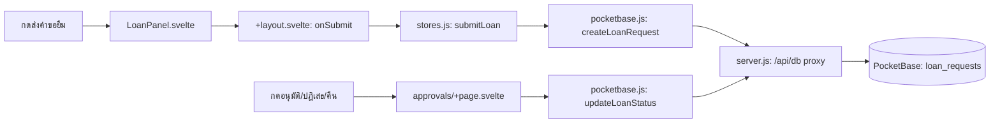

# brrow-item / Borrowly — กดแล้วโค้ดไปไหน

| ผู้ใช้ทำอะไร | ตามไฟล์และฟังก์ชัน | ผลลัพธ์ |
| --- | --- | --- |
| เลือกอุปกรณ์แล้วส่งคำขอ | [LoanPanel.svelte](src/lib/components/LoanPanel.svelte) เรียก `onSubmit` ที่ผูกใน [+layout.svelte](src/routes/+layout.svelte) → `submitLoan()` ใน [stores.js](src/lib/stores.js) → `createLoanRequest()` ใน [pocketbase.js](src/lib/pocketbase.js) → `/api/db` ใน [server.js](server.js) | สร้าง `loan_requests`; เมื่อสำเร็จล้างตะกร้าและแสดงข้อความสำเร็จ |
| กดอนุมัติ/ปฏิเสธ/คืนในหน้าตรวจคำขอ | [approvals/+page.svelte](src/routes/approvals/+page.svelte) `handleTeacherApprove`, `confirmApprove`, `confirmReject` หรือ `handleReturnLoan` → ฟังก์ชันสถานะใน [pocketbase.js](src/lib/pocketbase.js) | อัปเดต `loan_requests` ตามสิทธิ์และขั้นอนุมัติ |
| ผู้ยืมแก้ไข/ยกเลิกคำขอ | [requests/+page.svelte](src/routes/requests/+page.svelte) `saveEditing`/`cancelRequest` → `updateMyLoanRequest`/`cancelLoanRequest` ใน [pocketbase.js](src/lib/pocketbase.js) | แก้ record ของตนหรือเปลี่ยนสถานะเป็น cancelled |
| แอดมินเพิ่ม/แก้/ลบอุปกรณ์ | [admin/+page.svelte](src/routes/admin/+page.svelte) `submitItem`/`removeItem` → `createItem`/`updateItem`/`deleteItem` ใน [pocketbase.js](src/lib/pocketbase.js) | เปลี่ยน collection `items` |

อ่าน [คู่มือระบบ](../Docs/HandOn/borrowly.md) สำหรับกติกาสิทธิ์และ stock
