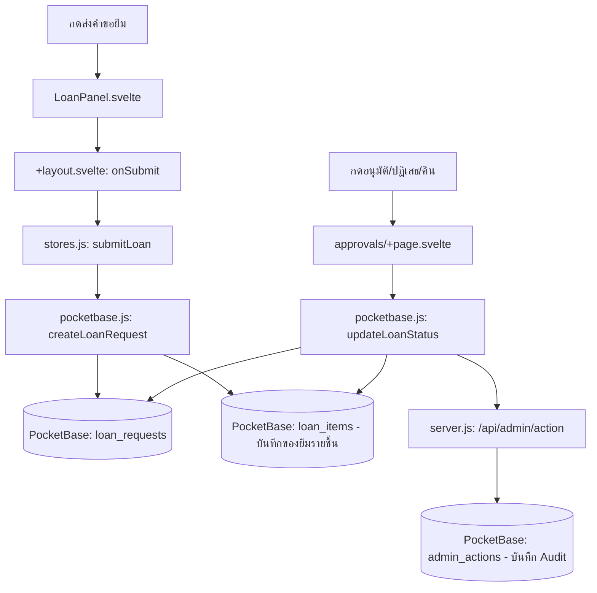

# brrow-item / Borrowly — กดแล้วโค้ดไปไหน

| ผู้ใช้ทำอะไร | ตามไฟล์และฟังก์ชัน | ผลลัพธ์ |
| :--- | :--- | :--- |
| **เลือกอุปกรณ์แล้วส่งคำขอ** | [LoanPanel.svelte](src/lib/components/LoanPanel.svelte) เรียก `onSubmit` ใน [+layout.svelte](src/routes/+layout.svelte) → `submitLoan()` ใน [stores.js](src/lib/stores.js) → `createLoanRequest()` ใน [pocketbase.js](src/lib/pocketbase.js) | สร้าง `loan_requests` และ sync แตกรายการลง `loan_items` รายชิ้นอัตโนมัติ |
| **กดอนุมัติ / ปฏิเสธ** | [approvals/+page.svelte](src/routes/approvals/+page.svelte) `confirmApprove`, `confirmReject` → `updateLoanStatus()` ใน [pocketbase.js](src/lib/pocketbase.js) | อัปเดตสถานะใน `loan_requests` / `loan_items` และส่งบันทึก Audit ลง `admin_actions` ผ่าน `/api/admin/action` |
| **กดคืนอุปกรณ์** | `handleReturnLoan` ใน [approvals/+page.svelte](src/routes/approvals/+page.svelte) → `updateLoanStatus()` ใน [pocketbase.js](src/lib/pocketbase.js) | ปรับสถานะเป็น returned, ตัดสต็อกคืนใน `items`, และอัปเดต `returned_at` ใน `loan_items` |
| **ผู้ยืมแก้ไข/ยกเลิกคำขอ** | [requests/+page.svelte](src/routes/requests/+page.svelte) `saveEditing`/`cancelRequest` → `updateMyLoanRequest`/`cancelLoanRequest` ใน [pocketbase.js](src/lib/pocketbase.js) | แก้ record ของตนหรือเปลี่ยนสถานะเป็น cancelled |
| **แอดมินจัดการอุปกรณ์** | [admin/+page.svelte](src/routes/admin/+page.svelte) `createItem`/`updateItem`/`deleteItem` | เพิ่ม/ลบ/แก้ไขข้อมูลในคอลเลกชัน `items` |

อ่าน [คู่มือระบบ](../Docs/HandOn/borrowly.md) สำหรับกติกาสิทธิ์และ stock
